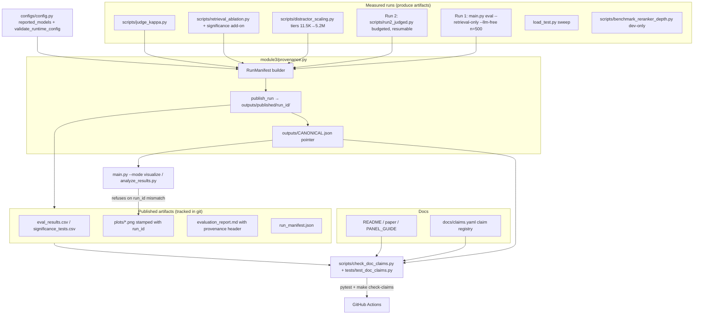
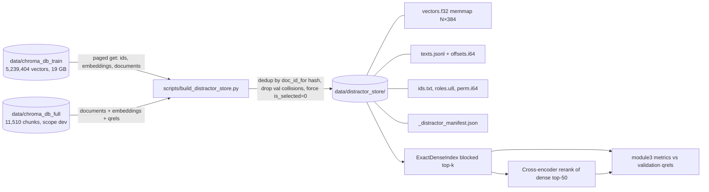
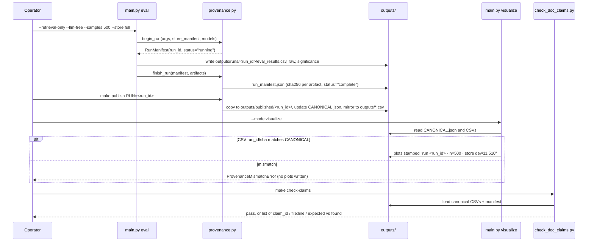
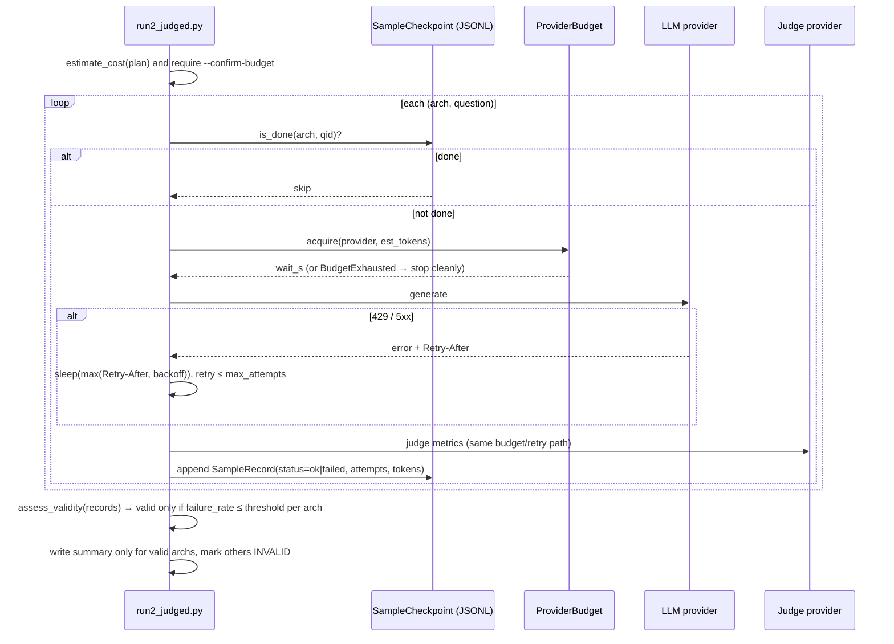

# Design Document: Capstone Review Readiness

## Overview

This design covers the work needed before the capstone review. Its goal is that every number and claim in `README.md`, `docs/paper.md` and `docs/PANEL_GUIDE.md` can be traced to a committed artifact that carries its own provenance, and that the results get stronger through new measured runs. No result is invented. Anything not yet measured is designed as a run that produces it, together with the check that decides whether the run is valid.

The work falls into three priority bands. **P0** (needed before any review) covers published-artifact consistency and provenance, a single source of truth for the reported generator and judge models, correction of documentation errors, an automated doc-claims checker, and a safe staged commit plan. **P1** covers a rate-limit-aware, resumable and budget-bounded Run 2 (LLM-judged metrics), a distractor-scaling experiment over a manifest-backed train-derived store built from the existing 5.24M embeddings, significance testing of the existing identical-pool ablation, the Parent-Child grading fix, and Cohen's kappa validation of the judge. **P2** covers a clean load test, a reranker depth sweep, optional BEIR evaluation and a CI retrieval-regression gate.

New code follows the existing layout. Knobs go in `configs/config.py`, library code goes in `module1`–`module5`, runnable experiments go in `scripts/`, tests go in `tests/` (pytest plus Hypothesis property tests), and commands get `Makefile` targets. The language is Python 3.12.14.

### Findings added during design (verified 2026-10-24)

1. **The n=500 rerun finished at 13:14.** `outputs/eval_results.csv` and `outputs/significance_tests.csv` were rewritten. Naive (nDCG@10 0.632), CRAG (0.575) and Rerank (0.699, Δ +0.0666, p_BH 1.8×10⁻⁶, d_z 0.218) match paper §5.1 to three decimals. **Parent-Child did not reproduce**: nDCG@10 is 0.523 and Hit Rate 0.696, against 0.632 and 0.889 in the paper.
2. **The Parent-Child drop is a grading artifact, not a retrieval result.** `main.py` eval mode now builds a real in-memory child store, so Parent-Child returns 1,200-character parent chunks. `doc_id_for()` hashes the full text, and `build_qrels()` builds relevance IDs from 400-character chunks, so a parent chunk can only match a qrel when the source passage was shorter than 400 characters. Relevant parents are therefore scored as non-relevant. The paper's "Parent-Child is identical to Naive" finding described the old fallback. The new number must not be published until it is graded at passage level (component C9).
3. **The identical-pool ablation already exists.** `scripts/retrieval_ablation.py` and `outputs/retrieval-ablation-local-20261019-v2/` (described in `docs/VALIDATION_2026-10-19_FOLLOWUP.md` §4) compare the same hybrid pool with and without the cross-encoder (nDCG 0.553 → 0.699, n=496). They also show that a dense-only pool plus the cross-encoder reaches 0.6986, within 0.0004 of the hybrid pool. That result is descriptive only, with no significance tests. Paper §5.2 still says the ablation "is needed". The remaining work is paired BH tests on the saved `per_query.jsonl` and moving the result into the paper (component C11). The near-zero BM25 contribution also justifies the dense-only first stage used in distractor scaling.
4. **The "@10" metrics are computed over at most 5 returned documents**, as the follow-up validation doc states ("MRR@10/nDCG@10 see only up to five returned documents"). The paper and README must label them, for example "nDCG@10 (depth ≤5)", or the protocol must change to a depth-10 list. This design keeps the Run 1 protocol and labels it (open question Q6).
5. `outputs/plots/ir_metrics.png` dates from Oct 20 22:08, before the rerun, so it still shows another run.

## Architecture



### Distractor store data flow



## Sequence Diagrams

### Publishing a run and guarding the demo



### Run 2 sample execution with budget, retry and checkpoint



## Components and Interfaces

### C1: Run provenance and published-artifact guard (P0)

**Purpose**: Every result artifact states which run produced it, and nothing (plots, report, demo, docs) can silently show a different run than the paper.

**Location**: new `module3/provenance.py`. Hooks go in `main.py` (`_run_evaluation`, `_run_visualization`), `module4/visualization.py` (`_save`, `generate_summary_report`) and `analyze_results.py`.

```python
# module3/provenance.py
from dataclasses import dataclass, field
from typing import Literal

RunStatus = Literal["running", "complete", "invalid", "aborted"]

@dataclass(frozen=True)
class ModelSpec:
    role: Literal["generator", "judge", "embedding", "reranker"]
    provider: str              # "openrouter" | "groq" | "mistral" | "local" | "none"
    model: str                 # slug actually used, e.g. "openai/gpt-oss-20b"
    revision: str | None       # HF snapshot sha for local models, None for APIs

@dataclass(frozen=True)
class StoreSpec:
    path: str
    scope: str                 # manifest scope: "dev" | "full" | "distractor" | ...
    split: str
    num_chunks: int
    build_id: str | None       # None only for legacy stores, flagged in manifest
    corpus_fingerprint: str | None

@dataclass
class RunManifest:
    run_id: str                # f"{utc:%Y%m%dT%H%M%SZ}-{kind}-{sha8}"
    kind: str                  # "run1-retrieval" | "run2-judged" | "distractor-scaling" | ...
    created_utc: str
    finished_utc: str | None
    status: RunStatus
    command: list[str]         # sys.argv
    n_requested: int
    n_evaluated: int
    n_judged_qrels: int        # e.g. 496
    question_subset_sha256: str
    seed: int
    store: StoreSpec
    models: list[ModelSpec]
    architectures: list[str]
    git_commit: str | None
    git_dirty: bool
    packages: dict[str, str]
    host: dict[str, str]       # platform, device, ram_gb
    artifacts: dict[str, str] = field(default_factory=dict)  # relpath -> sha256
    notes: list[str] = field(default_factory=list)

def begin_run(kind: str, args, store: StoreSpec, models: list[ModelSpec],
              questions: list[dict]) -> RunManifest: ...
def finish_run(manifest: RunManifest, run_dir: str, status: RunStatus) -> str: ...
def publish_run(run_id: str, *, mirror_to_outputs: bool = True) -> str: ...
def load_canonical(kind: str = "run1-retrieval") -> tuple[RunManifest, str]: ...
def verify_artifacts(manifest: RunManifest, base_dir: str) -> list[str]: ...
def stamp_text(manifest: RunManifest) -> str: ...  # "run 2026...Z · n=500 (496 judged) · dev store 11,510 chunks"
class ProvenanceMismatchError(RuntimeError): ...
```

**Responsibilities**:
- `begin_run` captures arguments, store manifest, models (from C2), the question-subset hash, git commit and dirty flag, and package versions before any work starts.
- Each run writes into `outputs/runs/<run_id>/`, so a run never overwrites another run's files. The legacy `outputs/eval_results.csv` path becomes a **mirror** that only `publish_run` writes.
- `publish_run` copies a `complete` run to `outputs/published/<run_id>/` (immutable), updates `outputs/CANONICAL.json` (`{kind: run_id}`), and mirrors the CSVs to the legacy paths with a leading `# run_id=...` comment row. pandas readers use `comment="#"`.
- `visualize` and `analyze_results.py` call `load_canonical` and `verify_artifacts`. On any sha256 or `run_id` mismatch they raise `ProvenanceMismatchError` and write nothing.
- Every plot gets a footer from `stamp_text()`. `evaluation_report.md` gets a provenance header table.
- `demo` mode keeps working but stamps its plots "DEMO DATA — not a measured run" and writes them to `outputs/plots/demo/`, so they can never replace published figures.

### C2: Single source of truth for reported models (P0)

**Purpose**: The models named in the docs are the models that were actually called, recorded per run.

**Location**: `configs/config.py`, `module2/rag_architectures.py::_LLM`, `module3/evaluation.py::RAGASEvaluator`.

```python
# configs/config.py
def active_generator() -> tuple[str, str]:
    """(provider, model) the _LLM wrapper will actually use, mirroring its priority:
    OPENROUTER_API_KEY → ('openrouter', GROQ_MODEL); GROQ_API_KEY → ('groq', GROQ_MODEL);
    MISTRAL_API_KEY → ('mistral', LLM_MODEL); else ('extractive', 'none')."""

def active_judge() -> tuple[str, str]:
    """(JUDGE_PROVIDER, JUDGE_MODEL) after key availability is applied."""

def reported_models() -> list["ModelSpec"]:
    """Generator, judge, embedding (+revision), reranker (+revision) for RunManifest."""
```

**Responsibilities**:
- `_LLM.__init__` and `RAGASEvaluator.__init__` log the resolved (provider, model) and expose `.provider` and `.model`. The run manifest records **those** values, not config defaults.
- Retrieval-only runs record generator and judge as `provider="none"`, so docs never attribute Run 1 to an LLM.
- Docs name models only through claims in `docs/claims.yaml` (C4) that resolve to the canonical Run 2 manifest. Until Run 2 is valid, docs say "configured generator/judge: see `.env.example`" and do not name a model as "used".
- The `.env.example` defaults are aligned to the code defaults. The chosen reporting pair is open question Q1.

### C3: Judge-decoupling checks and tests (P0)

The warning in `RAGASEvaluator.__init__` and the `validate_runtime_config()` problem already exist. This component adds tests and one behaviour decision.

```python
# tests/test_config_judge.py (extend)
def test_validate_flags_same_judge_and_generator(monkeypatch): ...
def test_validate_clean_with_code_defaults(monkeypatch): ...   # [] with API_KEY set, defaults
def test_validate_ignores_mistral_judge_same_slug(monkeypatch): ...
def test_ragas_evaluator_warns_when_judge_equals_generator(caplog, monkeypatch): ...
def test_run2_refuses_coupled_judge(monkeypatch): ...  # C5 preflight hard-fails, eval warns
```

**Decision**: `validate_runtime_config()` keeps returning the problem as a warning-level entry, because `api.py` startup logs problems and does not exit. `scripts/run2_judged.py` treats a coupled judge as **fatal** unless `--allow-coupled-judge` is passed, and the manifest records that flag. `tests/test_api_production.py::test_clean_config_has_no_problems` must still pass: with defaults, GROQ_MODEL `llama-3.1-8b-instant` ≠ JUDGE_MODEL `openai/gpt-oss-20b`, so `[]` holds. The test must reload `configs.config` with a monkeypatched environment that ignores the developer `.env`, matching how `make test` blanks provider keys.

### C4: Doc-claims registry and checker (P0)

**Purpose**: Numbers quoted in README, paper and PANEL_GUIDE are asserted against the canonical artifacts. A doc that drifts fails the check.

**Location**: `docs/claims.yaml`, `scripts/check_doc_claims.py`, `tests/test_doc_claims.py`, Makefile target `check-claims`.

```python
# scripts/check_doc_claims.py
from dataclasses import dataclass
from typing import Literal

SourceKind = Literal["summary", "significance", "manifest", "derived", "literal", "command"]

@dataclass(frozen=True)
class ClaimSource:
    kind: SourceKind
    run_kind: str | None        # CANONICAL.json key, e.g. "run1-retrieval"
    selector: dict              # e.g. {"architecture": "Rerank RAG", "column": "ndcg_at_10"}
    fmt: str                    # python format spec, e.g. ".3f", ".1%", ".1e"

@dataclass(frozen=True)
class Claim:
    claim_id: str               # "run1.rerank.ndcg10"
    source: ClaimSource
    tolerance: float            # absolute, after formatting precision
    occurrences: list["Occurrence"]

@dataclass(frozen=True)
class Occurrence:
    file: str                   # "docs/paper.md"
    anchor: str                 # regex with one capture group for the number
    required: bool = True       # missing occurrence is an error

@dataclass(frozen=True)
class ClaimResult:
    claim_id: str
    file: str
    line: int | None
    expected: str
    found: str | None
    ok: bool
    reason: str

def load_registry(path: str = "docs/claims.yaml") -> list[Claim]: ...
def resolve(claim: Claim, canon: dict) -> float | str: ...
def check(claims: list[Claim], repo_root: str) -> list[ClaimResult]: ...
def scan_unregistered_numbers(files: list[str], claims: list[Claim]) -> list[tuple[str, int, str]]: ...
def main(argv=None) -> int: ...   # exit 1 on any failed claim
```

**Responsibilities**:
- `derived` claims compute values from raw rows: miss rate, rescued and lost counts, latency ratio, PΩ Spearman ρ. They reuse the functions in `analyze_results.py`, refactored into importable `compute_*` helpers, so the analysis and the check cannot disagree.
- `command` claims are only for facts that need a subprocess (for example the test count). They run in `make check-claims` but are skipped in `pytest` to avoid recursion. **Preferred fix**: remove hard-coded test counts from docs entirely (see C6).
- `literal` claims pin static facts that tests already enforce: `TOP_K=5`, chunk 400/50, dedup prefix length, `RERANK_CANDIDATES=50`. They resolve against `configs.config` and the extractor source constants.
- `scan_unregistered_numbers` lists numbers with three or more decimals or `×10⁻` notation in the three docs that no claim covers. It is warn-only at first and becomes an error once the registry is complete.
- Placeholders `[TBD]` are allowed only inside sections listed in `claims.yaml: pending_sections` and only while the matching run kind has no canonical entry.

### C5: Robust Run 2 executor (P1)

**Purpose**: Produce valid LLM-judged metrics for the 8 LLM-dependent architectures (plus the LLM-free ones for generation metrics), or a clear INVALID verdict. Means are never reported over the samples that happened to survive.

**Location**: new `module3/llm_budget.py` (reusable), new `scripts/run2_judged.py`, and a refactor of `module2/rag_architectures._wait_for_provider` and `module3/evaluation._judge_wait` to share `ProviderBudget`.

```python
# module3/llm_budget.py
from dataclasses import dataclass

@dataclass(frozen=True)
class ProviderLimits:
    provider: str
    rpm: int                    # requests per minute
    tpm: int                    # tokens per minute
    daily_requests: int | None
    daily_tokens: int | None
    max_usd: float | None
    usd_per_1k_in: float
    usd_per_1k_out: float

class BudgetExhausted(RuntimeError): ...

class ProviderBudget:
    """Thread-safe token buckets (requests + tokens) per provider plus daily/USD caps.
    State persisted to outputs/runs/<run_id>/budget_state.json so resumes keep the count."""
    def __init__(self, limits: dict[str, ProviderLimits], state_path: str): ...
    def acquire(self, provider: str, est_in: int, est_out: int) -> float: ...  # seconds waited
    def settle(self, provider: str, used_in: int, used_out: int) -> None: ...
    def penalise(self, provider: str, retry_after_s: float) -> None: ...      # pause bucket on 429
    def snapshot(self) -> dict: ...

@dataclass(frozen=True)
class RetryPolicy:
    max_attempts: int = 6
    base_s: float = 2.0
    cap_s: float = 120.0
    retry_on: frozenset[int] = frozenset({408, 409, 425, 429, 500, 502, 503, 504, 529})

def parse_retry_after(headers: dict, now_epoch: float) -> float | None: ...
def call_with_retry(fn, *, provider: str, budget: ProviderBudget, policy: RetryPolicy,
                    est_in: int, est_out: int, rng) -> "CallOutcome": ...

@dataclass(frozen=True)
class CallOutcome:
    ok: bool
    value: object | None
    attempts: int
    status_codes: tuple[int, ...]
    waited_s: float
    tokens_in: int
    tokens_out: int
    error: str | None
```

```python
# scripts/run2_judged.py
@dataclass(frozen=True)
class Run2Plan:
    architectures: list[str]
    question_ids: list[str]
    stages_per_sample: dict[str, int]   # arch -> expected LLM calls (retrieval + gen + judge)
    est_tokens_in: dict[str, int]
    est_tokens_out: dict[str, int]

@dataclass(frozen=True)
class CostEstimate:
    calls_total: int
    calls_by_provider: dict[str, int]
    tokens_by_provider: dict[str, tuple[int, int]]
    usd_by_provider: dict[str, float]
    wall_clock_hours_at_limits: float

@dataclass
class SampleRecord:
    run_id: str
    architecture: str
    question_id: str
    status: Literal["ok", "failed", "abstained"]
    stage_failed: str | None            # "retrieval_llm" | "generation" | "judge:<metric>"
    attempts: int
    metrics: dict[str, float | None]
    tokens_in: int
    tokens_out: int
    elapsed_s: float

class SampleCheckpoint:
    def __init__(self, path: str, run_id: str): ...
    def done_keys(self) -> set[tuple[str, str]]: ...      # only status in {ok, abstained}
    def append(self, rec: SampleRecord) -> None: ...      # fsync per line
    def records(self) -> list[SampleRecord]: ...          # last record per key wins

@dataclass(frozen=True)
class ValidityVerdict:
    architecture: str
    expected: int
    ok: int
    failed: int
    abstained: int
    failure_rate: float
    valid: bool
    reason: str

def plan_run(args) -> Run2Plan: ...
def estimate_cost(plan: Run2Plan, limits: dict[str, ProviderLimits]) -> CostEstimate: ...
def assess_validity(records: list[SampleRecord], plan: Run2Plan,
                    max_failure_rate: float, max_abstain_rate: float) -> list[ValidityVerdict]: ...
def main(argv=None) -> int: ...
```

**Responsibilities**:
- Preflight: config validation (coupled judge is fatal), a one-call judge health check (already exists), a cost estimate printed and written to `cost_estimate.json`, and refusal to start without `--confirm-budget USD` that is ≥ the estimate. `--dry-run` stops after the estimate.
- Pilot first: `--pilot 5` runs 5 questions × all architectures and replaces estimated tokens with measured means before the full plan is re-estimated.
- Per-sample checkpoint in `outputs/runs/<run_id>/samples.jsonl`. `--resume <run_id>` skips `ok` and `abstained` keys and retries `failed` keys.
- `failed` (exhausted retries) is different from `abstained` (the model answered "insufficient context" by contract). Both count against validity separately.
- Validity: an architecture is valid only if `failure_rate ≤ RUN2_MAX_FAILURE_RATE` (default 0.02) **and** every metric has non-null values for all `ok` samples. Invalid architectures appear in the summary with `evaluation_valid=False` and no means. The run status is `invalid` if any planned architecture is invalid, unless `--partial-ok` is passed and recorded.
- Concurrency stays at 1 worker per provider by default. The free-tier Groq 429 storm in `judged_run4.log` came from request rate, so pacing by RPM and TPM rather than by a fixed 3-second gap is the fix.
- New knobs in `configs/config.py`: `RUN2_MAX_FAILURE_RATE`, `RUN2_MAX_ABSTAIN_RATE`, `PROVIDER_LIMITS` (parsed from env `PROVIDER_LIMITS_JSON` with documented defaults per provider), `RUN2_RETRY_MAX_ATTEMPTS`.

### C6: Documentation corrections (P0)

Each correction gets a matching claim or test where possible.

| # | Location | Current | Correction | Guard |
|---|---|---|---|---|
| D1 | README (any "220 automated tests") | 220 | Remove the hard-coded count. Say "run `make test`", or quote a count only via a `command` claim | C4 command claim, or no number |
| D2 | README "Security defaults" | open dev mode when API_KEY unset | Fails closed with 503. Only `ALLOW_UNAUTHENTICATED=true` on a numeric loopback HOST opens it | literal claim + existing `test_api_security` |
| D3 | PANEL_GUIDE §3g | "runs on the full train split" | "The train split (4.14M passages) was **embedded** (5.24M vectors). It is used as a distractor corpus in the scaling experiment (§5.x). It is not used as an evaluation set." | claim on distractor manifest counts |
| D4 | paper Appendix A | `--store train` working | Remove it, or replace with `make distractor-scaling` once C7/C8 exist | test: Appendix commands parse with `main.py` argparse and point at existing stores |
| D5 | paper §3.1 train chunks `[TBD]` | TBD | Fill from distractor manifest: raw vectors 5,239,404, unique after dedup = measured | manifest claim |
| D6 | paper §3.1 dedup prefix | 200 chars | Validation loader dedup prefix is checked in code. The train extractor uses 150. State both per split | literal claims from source constants |
| D7 | README title | "Synthetic-Data-Driven Evaluation" | Align to the paper title. Mention that synthetic queries are only the small-n fallback | literal |
| D8 | PANEL_GUIDE demo step 5 | expects 401 | Run the demo with `ALLOW_UNAUTHENTICATED=false API_KEY=... python api.py` explicitly, and show 401 (missing key) and 503 (no key configured) as separate steps | demo script `scripts/panel_demo.sh` + test that it sets the env |
| D9 | paper §5.2 / §6 / §7 / abstract, README | "129×" / "300×" | Replace with ratios derived from the canonical run's latency columns, with host and load stated. The clean load test (C13) supersedes them when done | derived claim |
| D10 | paper §5.2 | "identical-pool ablation is needed" | Report the existing five-way result with the C11 significance tests | C11 claims |
| D11 | paper §5.6, README | Parent-Child identical to Naive | Rewrite after C9. Until then: "the previous Parent-Child number reflected a fallback; regraded result in §5.x" | C9 claims |
| D12 | all "nDCG@10 / MRR@10" | unlabeled depth | Add "(ranked list depth 5)" footnote, or move to depth-10 per Q6 | literal claim on TOP_K |
| D13 | paper §6.1 | duplicated "### 6.1 Threats to validity" heading | Remove the duplicate | markdown lint check in C4 |
| D14 | README pipeline diagram, Technologies table | Llama/GPT-OSS via Groq | Resolve via C2 after Q1 | manifest claim |

### C7: Distractor store builder from existing embeddings (P1)

**Purpose**: Build a manifest-backed, deduplicated, memory-safe corpus of validation chunks (with qrels) plus train chunks as distractors, **without re-embedding**.

**Location**: `scripts/build_distractor_store.py`, plus library helpers in `module1/distractor_store.py`.

```python
# module1/distractor_store.py
ROLE_EVAL = 0        # validation chunk, carries qrels
ROLE_DISTRACTOR = 1  # train chunk, is_selected forced 0

@dataclass(frozen=True)
class DistractorManifest:
    manifest_version: int
    scope: Literal["distractor"]
    embedding_model: str
    embedding_revision: str
    embedding_dim: int                  # 384
    normalized: bool                    # True; verified on build
    chunk_size: int                     # 400
    chunk_overlap: int                  # 50
    eval_source: dict                   # chroma_db_full path, build_id/fingerprint, num_chunks
    distractor_source: dict             # chroma_db_train path, raw_count=5_239_404, sqlite sha of header
    eval_count: int                     # 11,510 (or unique count; see dedup rule)
    distractor_raw: int
    distractor_dup_removed: int         # expected ≈ 6,002 plus any cross-text dups
    distractor_eval_collisions: int     # train texts identical to a validation chunk, dropped
    distractor_count: int
    total: int
    permutation_seed: int               # 42
    tiers: list[int]                    # [11_510, 100_000, 1_000_000, total]
    embedding_identity_check: dict      # n_sampled, min_cosine, mean_cosine
    files: dict[str, str]               # name -> sha256
    build_id: str
    created_utc: str

def iter_chroma_records(store_dir: str, page: int = 50_000):
    """Yield (id, text, embedding[384], metadata) batches from a Chroma persistent store.
    Pages by an ordered id list read once from the collection (no OFFSET scans)."""

def build(eval_dir: str, train_dir: str, out_dir: str, *, seed: int = 42,
          tiers: list[int] | None = None, identity_sample: int = 1000) -> DistractorManifest: ...

class DistractorStore:
    def __init__(self, out_dir: str): ...          # verifies manifest + file sha256
    @property
    def size(self) -> int: ...
    def tier_rows(self, tier: int) -> "np.ndarray": ...   # eval rows ∪ perm[:tier-eval_count]
    def vectors(self) -> "np.memmap": ...                 # read-only, shape (total, 384)
    def text(self, row: int) -> str: ...
    def doc_id(self, row: int) -> str: ...                # doc_id_for(text); distractors prefixed "d:"
    def qrels(self) -> dict[str, set[str]]: ...           # from eval rows only
```

**Responsibilities**:
- Read eval chunks and their **stored** embeddings from `chroma_db_full`, so tier 0 uses the same vectors as Run 1, and build qrels with the existing `build_qrels`.
- Stream train records, compute `doc_id_for(text)`, keep the first occurrence of each hash, and drop any text whose hash equals an eval chunk hash. Collisions are counted, not merged, because an identical text with a train-side judgement would be ambiguous. Force `is_selected=0` and record `role=DISTRACTOR`.
- Embedding identity check: re-embed `identity_sample` random train texts with the pinned MiniLM revision and assert cosine ≥ 0.999 against stored vectors, and assert norms are within 1±1e-3. On failure, abort and state that re-embedding is required (the 18.5-hour fallback).
- Write `vectors.f32` (memmap, about 8.05 GB at 5.24M×384), `texts.jsonl` plus `offsets.i64` (random access for the reranker), `ids.txt`, `roles.u8`, and `perm.i64` (seeded permutation of distractor rows). Then write `_distractor_manifest.json` atomically via `atomic_write_json`.
- Build into a private staging dir under `build_lock_for(out_dir)`, then publish with the same rename discipline as `preprocess_full._publish_vector_store`. Never modify `chroma_db_train` or `chroma_db_full`.
- `main.py --store` gets a clear error for scope `distractor` and for the legacy train store: "this store has no qrels for its own queries; use `make distractor-scaling`". The current traceback-style `IndexManifestError` is replaced by that message.

**Optional train-qrels backfill (P2, decision Q4)**: re-run only `preprocess_train.phase_extract` (no embedding) into `_train_documents_v2.jsonl` with the new `query` field, then join to existing vectors by `doc_id_for(text)`. That yields train-split qrels for a train-query eval without re-embedding. Cost: extraction time only (HF dataset must be in the offline cache).

### C8: Distractor-scaling experiment (P1)

**Purpose**: Measure how retrieval quality and the rerank gain change as the corpus grows from the easy 11.5K dev corpus towards MS MARCO scale. This answers the "your corpus is too easy" objection with data.

**Location**: `scripts/distractor_scaling.py`, `module2/exact_dense.py`, Makefile `distractor-scaling`.

```python
# module2/exact_dense.py
class ExactDenseIndex:
    """Exact inner-product top-k over a row subset of a float32 memmap, streamed in blocks.
    Exact search removes ANN recall as a confound across tiers."""
    def __init__(self, vectors: "np.memmap", rows: "np.ndarray", block_rows: int = 262_144): ...
    def search(self, queries: "np.ndarray", k: int) -> tuple["np.ndarray", "np.ndarray"]: ...
        # returns (scores[q,k], rows[q,k]) sorted desc, ties broken by smaller row id

# scripts/distractor_scaling.py
@dataclass(frozen=True)
class ScalingCondition:
    name: Literal["dense_only", "dense_pool_rerank"]
    pool_k: int                 # 50 for rerank
    final_k: int                # TOP_K = 5

@dataclass(frozen=True)
class TierResult:
    tier: int
    condition: str
    n_judged: int
    ndcg_at_10: float; ndcg_ci: tuple[float, float]
    mrr_at_10: float;  mrr_ci: tuple[float, float]
    recall_at_k: float; recall_ci: tuple[float, float]
    hit_rate: float
    pool_recall_at_50: float    # fraction of judged queries with ≥1 relevant in dense top-50
    distractor_share_top5: float
    search_ms_per_query: float
    rerank_ms_per_query: float | None

def run_scaling(store: "DistractorStore", questions: list[dict], tiers: list[int],
                conditions: list[ScalingCondition], reranker, *, seed: int) -> list[TierResult]: ...
def paired_tests(per_query: "pd.DataFrame") -> "pd.DataFrame": ...  # reuse module3.test_metric_significance
```

**Responsibilities**:
- Questions are the same 500 seeded Run 1 questions (subset sha256 must equal `70e4a602…`). Grading uses validation qrels only, 496 judged.
- Conditions per tier: `dense_only` (top-5) and `dense_pool_rerank` (dense top-50 → bge-reranker-base → top-5). BM25 is excluded at all tiers: `rank_bm25` holds the full tokenised corpus in RAM, which will not fit at 5M chunks in 16 GB. The five-way ablation (finding 3) shows the dense pool plus the cross-encoder is within 0.0004 nDCG of the hybrid pool at 11.5K, so this costs little and the doc says so.
- Tier-0 sanity gate: `dense_only` at tier 11,510 must reproduce Run 1 Naive nDCG@10 within 0.002, and `dense_pool_rerank` must reproduce the five-way "dense pool + cross-encoder" 0.6986 within 0.002. If a gate fails, the run is marked invalid before larger tiers are run.
- Statistics: per-tier bootstrap CIs (1,000, seed 42). Paired tests of rerank vs dense within each tier, and of each tier vs tier 0 within each condition, with BH correction across the family.
- Outputs go to `outputs/runs/<run_id>/`: `per_query.jsonl`, `tier_summary.csv`, `significance.csv`, `plots/scaling.png` (nDCG@10 / MRR@10 / Recall vs log corpus size, with CIs), and a RunManifest of kind `distractor-scaling`.
- The doc interpretation states that distractors are unjudged train passages, so a relevant-but-unjudged distractor counts as non-relevant. Metrics at large tiers are therefore lower bounds, and the same bias applies to both conditions.

### C9: Parent-Child passage-level grading (P1)

**Purpose**: Grade architectures that return text spans different from the indexed 400-character chunks (Parent-Child, RAPTOR summaries) against the same human labels.

**Location**: `module1/data_preprocessing.py` (passage lineage metadata), `module3/evaluation.py` (passage-level qrels and metrics).

```python
# module1: every Document from load_msmarco_documents gets
#   metadata["passage_id"] = doc_id_for(full_passage_text)
# and chunk_documents / build_parent_child_chunks propagate it (LangChain splitters copy metadata).

# module3/evaluation.py
def build_passage_qrels(docs) -> dict[str, set[str]]: ...   # question -> {passage_id}
def passage_ids_for(retrieved: list) -> list[str]: ...       # dedup in rank order; missing passage_id → doc_id_for
GradingLevel = Literal["chunk", "passage"]
```

**Responsibilities**:
- All architectures get **both** chunk-level metrics (unchanged; preserves comparability with Run 1) and passage-level metrics (new columns with suffix `_psg`).
- Parent-Child and any summary-returning architecture are compared at passage level only. The summary marks chunk-level values for them as `not_comparable`.
- Parent chunks span several passages only if the splitter merges passages. It does not, because `split_documents` operates per Document, so each parent inherits exactly one `passage_id`. A test asserts this.
- Regression test: with a synthetic corpus where every passage exceeds 1,200 characters, chunk-level Parent-Child Hit Rate is 0 and passage-level Hit Rate equals the oracle. This reproduces the artifact and proves the fix.
- Changing passage metadata changes the corpus fingerprint. That is handled by building a new store version with a new manifest. The Run 1 dev store is not mutated (risk R3).

### C10: Judge validation with Cohen's kappa (P1)

**Location**: `scripts/judge_kappa.py` (sample, label, score), `module3/agreement.py`.

```python
# module3/agreement.py
def cohen_kappa(a: list[int], b: list[int], labels: list[int]) -> float: ...
def weighted_kappa(a, b, labels, weights: Literal["linear", "quadratic"]) -> float: ...
def kappa_bootstrap_ci(a, b, labels, iters=1000, seed=42) -> tuple[float, float]: ...
def binarize(score: float, threshold: float) -> int: ...

# scripts/judge_kappa.py
#   sample   --run <run2_id> --n 50 --strata arch  → outputs/judge_kappa/<id>/to_label.jsonl (judge scores hidden)
#   label    --file to_label.jsonl --annotator A  → interactive CLI, writes labels_A.jsonl (resumable)
#   score    --labels labels_A.jsonl [labels_B.jsonl] → kappa.json, confusion.csv
```

**Responsibilities**:
- Sample 50 (question, context, answer) triples from **valid** Run 2 samples, stratified by architecture, with seed 42.
- The labeller sees question, context and answer but not the judge score. Faithfulness gets a 3-point label (0 unsupported, 1 partially supported, 2 fully supported) plus a binary "fully supported".
- Report: Cohen's κ (binary, judge thresholded at `FAITHFULNESS_THRESHOLD`), quadratic-weighted κ (3-point vs judge score bucketed at 1/3 and 2/3), bootstrap CI, raw agreement and the confusion matrix. With two annotators, also report human-human κ as the ceiling.
- Recommended: two team members label independently (open question Q5).

### C11: Significance for the existing identical-pool ablation (P1)

**Location**: `scripts/ablation_significance.py`.

```python
def load_per_query(path: str) -> "pd.DataFrame": ...         # outputs/retrieval-ablation-local-20261019-v2/per_query.jsonl
CONTRASTS = [
    ("hybrid_reranked", "hybrid_no_rerank"),   # cross-encoder effect, identical pool
    ("dense_reranked", "dense_only"),          # cross-encoder effect, dense pool
    ("hybrid_no_rerank", "dense_only"),        # pool widening + RRF effect, no CE
    ("hybrid_reranked", "dense_reranked"),     # BM25 contribution given CE
]
def run(per_query, metrics=("ndcg_at_10","mrr_at_10","recall_at_k","hit_rate")) -> "pd.DataFrame": ...
```

The script reuses `module3.evaluation.test_metric_significance` and `benjamini_hochberg`, with the family = 4 contrasts × 4 metrics. It verifies the ablation's own `contract.json` fingerprints before computing anything, and writes a RunManifest of kind `ablation-significance` that references the source run. Paper §5.2 then reports the causal split between pool and cross-encoder.

### C12: Version control plan (P0)

This is a procedure plus a check script, `scripts/precommit_audit.py`. It is not a feature module.

```python
def audit_staged(repo_root: str) -> list[str]:
    """Fail if any staged path matches: .env (not .env.example), *.pem, *.key, data/**,
    .opencode/**, .omnirush/**, node_modules/**, outputs/runs/** (non-published), *.log,
    files > 5 MB not in an allowlist, or content matching key patterns
    (sk-or-, gsk_, 'API_KEY=' with a non-empty value)."""
```

`.gitignore` additions (in `rag_project/.gitignore`):

```text
# ── Agent/tool workspaces ─────────────────────────────────────────────
.opencode/
.omnirush/
node_modules/
# ── Run outputs: only published runs + canonical mirrors are tracked ──
outputs/runs/
outputs/archive/
outputs/judge_kappa/**/labels_*.jsonl.tmp
data/distractor_store/
```

**Tracked outputs**: `outputs/CANONICAL.json`, `outputs/published/<run_id>/**` (CSVs, manifest, small JSON), the mirrored `outputs/eval_results.csv` and `outputs/significance_tests.csv`, `outputs/evaluation_report.md`, `outputs/plots/*.png` (published only), the `outputs/validation-20261019/` summary and provenance, `outputs/retrieval-ablation-local-20261019-v2/`, and `outputs/load_test*.json`. `raw_eval_results.csv` stays ignored at the top level but is tracked inside `published/<run_id>/` if it is under 5 MB (n=500 × 4 arch is small). Otherwise it is stored gzip-compressed. Logs stay ignored; a log cited by the paper is copied into `published/<run_id>/` as `run.log`.

**Staged commit sequence** (each step: `git add <explicit paths>`, `python scripts/precommit_audit.py`, `make test lint`, commit):

1. `chore: ignore agent workspaces and run scratch dirs`: `.gitignore` only.
2. `fix(config): judge/generator decoupling checks + tests`: `configs/config.py`, `module3/evaluation.py`, `tests/test_config_judge.py`, `.env.example`.
3. `feat: run provenance + publish guard`: `module3/provenance.py`, `main.py`, `module4/visualization.py`, `analyze_results.py`, tests.
4. `chore: add operational/validation code`: `observability.py`, `load_test.py`, `RUNBOOK.md`, new `module5/*`, `scripts/*` (reviewed per file with `git diff --stat`, and per untracked file with `git status --porcelain`).
5. `data: publish canonical Run 1 (n=500) artifacts`: `outputs/CANONICAL.json`, `outputs/published/<run_id>/`, mirrors, plots.
6. `docs: correct claims + claims registry + checker`: `docs/**`, `README.md`, `docs/claims.yaml`, `scripts/check_doc_claims.py`, `tests/test_doc_claims.py`.
7. `docs: mark n=12 results superseded`: if the old n=12 files remain anywhere in the tree, move them under `outputs/archive/n12-superseded/` with a README. History is not rewritten.
8. Push to a branch `review-readiness` and open a PR. **Not** a force push to main (Q3).

The 40 modified files are reviewed with `git diff` before staging. Changes not made by this work are listed back to the user rather than bundled.

### C13: Clean load test with concurrency sweep (P2)

**Location**: extend `load_test.py` with `--sweep 1,4,8,16,32` and `--idle-check`, and add `scripts/idle_check.py`.

```python
def idle_check(max_cpu_pct: float = 15.0, window_s: int = 30) -> dict: ...   # psutil; aborts if busy
def sweep(url: str, key: str, arch: str, levels: list[int], requests: int,
          warmup: int, cache_mode: Literal["cold", "warm"]) -> list[dict]: ...
```

- Cold-path runs use unique questions, sampled from the 500-question set and never repeated, or a `?nocache=1` admin flag behind `X-API-Key` so the semantic cache cannot hide retrieval cost. Warm-path runs repeat questions.
- Per level, record throughput, p50/p95/p99, the error breakdown (503 shed, 504 timeout, other) and the server's `rag_inflight_requests` from `/metrics`.
- The output is a RunManifest of kind `load-test` including the idle-check result. PANEL_GUIDE §3f and the ROADMAP item cite only this run.

### C14: Reranker candidate-depth sweep, dev-only (P2)

`scripts/benchmark_reranker_depth.py` already exists. The work is to switch it to the C8 `ExactDenseIndex` dense pool at depths 20/50/100/200, run it on **dev questions disjoint from the 500 evaluation questions** (seeded sample from validation queries 1,000–1,999 against a tier containing their passages, or the first 1,000 minus the eval 500), and emit nDCG@10 vs rerank ms. A guard asserts dev ∩ eval question IDs = ∅. Any `RERANK_CANDIDATES` change is chosen from dev and then confirmed once on eval.

### C15: BEIR multi-domain retrieval (P2, optional)

`scripts/beir_eval.py` runs dense-only and dense-pool-rerank over 2–3 small BEIR sets (SciFact, NFCorpus, FiQA) using their official qrels and the `ExactDenseIndex`. It needs new dependencies (`beir` or `ir_datasets`) and a download, so it is gated on Q7.

### C16: CI retrieval-regression gate (P2)

A deterministic gate in GitHub Actions cannot use MS MARCO (download and model sizes). Design:
- `tests/fixtures/retrieval_gate/`: a frozen corpus of 2,000 chunks, 100 judged queries and **precomputed** MiniLM embeddings (about 3 MB), plus a stored baseline `baseline.json` (dense nDCG@10).
- `tests/test_retrieval_gate.py` runs `ExactDenseIndex` over the fixture and fails if nDCG@10 < baseline − 0.005. This catches metric, qrels and ranking regressions without network access.
- A separate workflow `retrieval_gate_full.yml` (manual dispatch, self-hosted or local) runs the full n=500 LLM-free eval and compares against `CANONICAL.json` with the same tolerance.

## Data Models

### outputs/CANONICAL.json

```json
{
  "schema": 1,
  "runs": {
    "run1-retrieval": "20261024T131400Z-run1-retrieval-a1b2c3d4",
    "ablation-significance": null,
    "distractor-scaling": null,
    "run2-judged": null,
    "judge-kappa": null,
    "load-test": null
  },
  "updated_utc": "2026-10-24T…Z"
}
```

**Validation rules**: every non-null value names a directory under `outputs/published/` whose `run_manifest.json` has `status == "complete"`, a matching `kind`, and artifacts whose sha256 values all match.

### Mirrored CSV header

The first line is `# run_id=<id> kind=<kind> n=<n> store=<scope>/<num_chunks> created=<utc>`. All readers use `pd.read_csv(..., comment="#")`, and `verify_artifacts` checks the line matches CANONICAL.

### docs/claims.yaml (excerpt)

```yaml
version: 1
pending_sections:
  - {file: docs/paper.md, heading: "5.3 Generation quality", until: run2-judged}
  - {file: docs/paper.md, heading: "5.4 GRACE-Ω ablations", until: run2-judged}
claims:
  - id: run1.rerank.ndcg10
    source: {kind: summary, run_kind: run1-retrieval,
             selector: {architecture: "Rerank RAG", column: ndcg_at_10}, fmt: ".3f"}
    tolerance: 0.0005
    occurrences:
      - {file: docs/paper.md, anchor: "\\*\\*Rerank RAG\\*\\* \\| \\*\\*([0-9.]+)\\*\\*"}
      - {file: README.md,     anchor: "\\*\\*Rerank RAG\\*\\* \\| \\*\\*([0-9.]+)\\*\\*"}
      - {file: docs/PANEL_GUIDE.md, anchor: "\\*\\*Rerank RAG\\*\\* \\| \\*\\*([0-9.]+)\\*\\*"}
  - id: run1.miss_rate.naive
    source: {kind: derived, run_kind: run1-retrieval,
             selector: {fn: miss_rate, architecture: "Naive RAG"}, fmt: ".1%"}
    tolerance: 0.0005
    occurrences:
      - {file: docs/paper.md, anchor: "Naive RAG \\| ([0-9.]+%)"}
  - id: config.top_k
    source: {kind: literal, selector: {module: configs.config, name: TOP_K}, fmt: "d"}
    tolerance: 0
    occurrences:
      - {file: docs/paper.md, anchor: "Retrieval depth:\\*\\* k=([0-9]+)"}
```

**Validation rules**: claim IDs are unique; every anchor regex has exactly one capture group; `tolerance ≥ 0`; `run_kind` exists as a CANONICAL key; a `required` occurrence that matches zero times is an error, and one that matches more than once is an error unless `multi: true`.

### SampleRecord JSONL (Run 2 checkpoint)

One JSON object per line, as in C5. The key is `(architecture, question_id)`. Lines are append-only and fsynced. When a key has several lines, the last one wins.

### Distractor store files

| File | Type | Shape / size (full) |
|---|---|---|
| `vectors.f32` | float32 memmap, row-major | (N, 384), about 8.05 GB at N≈5.25M |
| `offsets.i64` | int64 | (N+1,) byte offsets into `texts.jsonl` |
| `texts.jsonl` | `{"t": text}` per row | about 2 GB |
| `ids.txt` | doc_id per row (`d:` prefix for distractors) | N lines |
| `roles.u8` | 0 eval / 1 distractor | (N,) |
| `perm.i64` | permutation of distractor row indices | (N − eval_count,) |
| `_distractor_manifest.json` | DistractorManifest | small |

**Validation rules**: rows `[0, eval_count)` are eval rows. `roles` has no 0 at index ≥ eval_count. `ids` are unique. Each `perm` value is a valid distractor row and appears exactly once. Every file sha256 matches the manifest. Vector norms are within 1±1e-3.

## Algorithmic Pseudocode

### A1: Publish and guard

```python
def publish_run(run_id: str, *, mirror_to_outputs: bool = True) -> str:
    src = os.path.join(OUTPUTS_DIR, "runs", run_id)
    manifest = RunManifest.load(os.path.join(src, "run_manifest.json"))
    assert manifest.status == "complete", "only complete runs are publishable"
    problems = verify_artifacts(manifest, src)
    if problems:
        raise ProvenanceMismatchError(problems)
    dst = os.path.join(OUTPUTS_DIR, "published", run_id)
    if os.path.exists(dst):
        raise FileExistsError(dst)                    # published runs are immutable
    shutil.copytree(src, dst)
    canon = _load_canonical_file()
    canon["runs"][manifest.kind] = run_id
    atomic_write_json(CANONICAL_PATH, canon)
    if mirror_to_outputs and manifest.kind == "run1-retrieval":
        for name in ("eval_results.csv", "significance_tests.csv"):
            _write_with_header(os.path.join(dst, name), os.path.join(OUTPUTS_DIR, name), manifest)
    return dst
```

**Preconditions**: `outputs/runs/<run_id>/run_manifest.json` exists, and every artifact listed in it exists.
**Postconditions**: `published/<run_id>` is a byte-identical copy. CANONICAL names `run_id` for its kind. Mirrors carry the header. No earlier published run is modified.

### A2: Rate-limited call with retry

```python
def call_with_retry(fn, *, provider, budget, policy, est_in, est_out, rng) -> CallOutcome:
    codes, waited = [], 0.0
    for attempt in range(1, policy.max_attempts + 1):
        waited += budget.acquire(provider, est_in, est_out)   # may raise BudgetExhausted
        try:
            value, used_in, used_out = fn()
            budget.settle(provider, used_in, used_out)
            return CallOutcome(True, value, attempt, tuple(codes), waited, used_in, used_out, None)
        except ProviderHTTPError as exc:
            codes.append(exc.status)
            budget.settle(provider, est_in, 0)                # count the attempt against budget
            if exc.status not in policy.retry_on or attempt == policy.max_attempts:
                return CallOutcome(False, None, attempt, tuple(codes), waited, est_in, 0, str(exc))
            ra = parse_retry_after(exc.headers, time.time())
            backoff = rng.uniform(0, min(policy.cap_s, policy.base_s * 2 ** (attempt - 1)))
            delay = max(ra or 0.0, backoff)
            if ra is not None:
                budget.penalise(provider, ra)                 # pause all callers on this provider
            time.sleep(delay); waited += delay
    raise AssertionError("unreachable")
```

**Preconditions**: `policy.max_attempts ≥ 1`; `fn` is idempotent (a generation or judge call with no side effects).
**Postconditions**: returns after at most `max_attempts` calls to `fn`. Each sleep is ≥ the server's Retry-After when it is present. Every attempt is charged to the budget. Exceptions other than `ProviderHTTPError` and `BudgetExhausted` propagate.
**Loop invariant**: `len(codes) == attempt - 1` at the top of each iteration, and the budget's request count has risen by exactly `attempt - 1`.

### A3: Validity assessment

```python
def assess_validity(records, plan, max_failure_rate, max_abstain_rate):
    latest = {(r.architecture, r.question_id): r for r in records}       # last wins
    out = []
    for arch in plan.architectures:
        expected = len(plan.question_ids)
        rs = [latest.get((arch, q)) for q in plan.question_ids]
        ok = sum(r is not None and r.status == "ok" for r in rs)
        ab = sum(r is not None and r.status == "abstained" for r in rs)
        failed = expected - ok - ab                                       # missing counts as failed
        fr, ar = failed / expected, ab / expected
        complete_metrics = all(all(v is not None for v in r.metrics.values())
                               for r in rs if r is not None and r.status == "ok")
        valid = fr <= max_failure_rate and ar <= max_abstain_rate and complete_metrics
        out.append(ValidityVerdict(arch, expected, ok, failed, ab, fr, valid,
                                   _reason(fr, ar, complete_metrics)))
    return out
```

**Postconditions**: `ok + failed + abstained == expected` for every architecture. A sample that was never attempted counts as failed. `valid` implies `failure_rate ≤ max_failure_rate`.

### A4: Distractor store build

```python
def build(eval_dir, train_dir, out_dir, *, seed=42, tiers=None, identity_sample=1000):
    with build_lock_for(out_dir) as lock:
        stage = create_staging_dir(os.path.dirname(out_dir), ".distractor.", out_dir, lock)
        w = _RowWriter(stage, dim=EMBEDDING_DIM)                     # appends vectors/texts/ids/roles
        eval_hashes = set()
        for batch in iter_chroma_records(eval_dir):
            for id_, text, vec, meta in batch:
                h = doc_id_for(text)
                if h in eval_hashes:                                 # 74 known dup texts: keep first
                    continue
                eval_hashes.add(h); w.add(vec, text, h, ROLE_EVAL, meta)
        eval_count = w.count
        seen, raw, dups, coll = set(), 0, 0, 0
        for batch in iter_chroma_records(train_dir):
            for id_, text, vec, meta in batch:
                raw += 1
                h = doc_id_for(text)
                if h in eval_hashes: coll += 1; continue
                if h in seen:        dups += 1; continue
                seen.add(h); w.add(vec, text, "d:" + h, ROLE_DISTRACTOR, {"is_selected": 0})
        # invariant: w.count == eval_count + (raw - dups - coll)
        ident = _embedding_identity_check(stage, eval_count, identity_sample, seed)
        if ident["min_cosine"] < 0.999:
            raise EmbeddingMismatchError(ident)
        perm = np.random.default_rng(seed).permutation(w.count - eval_count) + eval_count
        np.save(os.path.join(stage, "perm.i64.npy"), perm)
        manifest = _manifest(stage, eval_count, raw, dups, coll, tiers, seed, ident)
        atomic_write_json(os.path.join(stage, "_distractor_manifest.json"), asdict(manifest))
        _publish_dir(stage, out_dir, lock=lock)
        return manifest
```

**Preconditions**: both source stores exist and are not being written (build lock / no writer). There is ≥ 12 GB free disk.
**Postconditions**: as in the data-model rules; source stores are unchanged.
**Loop invariant**: `seen ∩ eval_hashes = ∅`, and `w.count == eval_count + |seen|`.
**Memory**: `seen` holds about 5.2M 20-character hex strings, roughly 0.6 GB as Python str. If that is too much, store 8-byte prefixes in a sorted numpy array per page plus a final `np.unique` pass. Vectors are streamed to disk, never held in full.
**Dedup rule note**: eval dedup keeps the first of the 74 duplicate texts. This matches the five-way ablation protocol (11,436 unique), not Run 1 (11,510 with duplicate credit). The tier-0 gate (C8) therefore compares against the five-way dense-only number 0.6314 rather than 0.6324. Alternatively, the build keeps duplicates in eval rows to match Run 1 (Q6). This must be decided before the build.

### A5: Exact blocked top-k

```python
def search(self, queries, k):
    qn = queries.astype(np.float32)                      # (Q, d), normalised
    best_s = np.full((len(qn), k), -np.inf, np.float32)
    best_r = np.full((len(qn), k), -1, np.int64)
    rows = np.sort(self.rows)                            # deterministic order
    for start in range(0, len(rows), self.block_rows):
        blk = rows[start:start + self.block_rows]
        s = qn @ np.asarray(self.vectors[blk]).T         # (Q, B)
        cand_s = np.concatenate([best_s, s], axis=1)
        cand_r = np.concatenate([best_r, np.broadcast_to(blk, s.shape)], axis=1)
        idx = _topk_stable(cand_s, cand_r, k)            # sort by (-score, row)
        best_s = np.take_along_axis(cand_s, idx, 1); best_r = np.take_along_axis(cand_r, idx, 1)
    return best_s, best_r
```

**Loop invariant**: after processing blocks `0..i`, `best_r[q]` is exactly the top-k rows by (score desc, row asc) among the rows seen so far.
**Postconditions**: the result equals brute-force top-k over `self.rows`, with ties resolved by smaller row id.
**Memory**: block 262,144 rows × 384 × 4 B = 384 MiB, plus scores Q×B×4 B (100 MiB at Q=100). Queries are processed in batches of 100. Peak is about 1 GB.

### A6: Doc-claims check

```python
def check(claims, repo_root):
    canon = _load_all_canonical(repo_root)
    results = []
    for c in claims:
        expected_val = resolve(c.source, canon)                  # raises if run kind missing
        expected = format(expected_val, c.source.fmt)
        for occ in c.occurrences:
            text = _read(repo_root, occ.file)
            matches = list(re.finditer(occ.anchor, text))
            if not matches:
                results.append(ClaimResult(c.claim_id, occ.file, None, expected, None,
                                           not occ.required, "anchor not found")); continue
            for m in matches:
                found = m.group(1)
                ok = _close(found, expected_val, c.source.fmt, c.tolerance)
                results.append(ClaimResult(c.claim_id, occ.file, _line(text, m.start()),
                                           expected, found, ok, "" if ok else "mismatch"))
    return results
```

## Key Functions with Formal Specifications

### `verify_artifacts(manifest, base_dir) -> list[str]`
- **Pre**: `manifest.artifacts` maps relative paths to hex sha256.
- **Post**: returns `[]` iff every listed file exists under `base_dir` and its sha256 matches. Otherwise returns one message per problem. It never modifies files.

### `ProviderBudget.acquire(provider, est_in, est_out) -> float`
- **Pre**: `provider` is in `limits`, and `est_in, est_out ≥ 0`.
- **Post**: the return value is the seconds slept (≥ 0). After return, the requests in the trailing 60 s are ≤ `rpm` and the tokens in the trailing 60 s are ≤ `tpm` (counting this call). It raises `BudgetExhausted` without sleeping if a daily or USD cap would be exceeded. It is thread-safe.

### `assess_validity(...)`
- See A3. **Post**: deterministic for a given records multiset (independent of order, except last-wins per key, which uses file order).

### `DistractorStore.tier_rows(tier) -> np.ndarray`
- **Pre**: `eval_count ≤ tier ≤ size`.
- **Post**: returns `concat(arange(eval_count), perm[:tier - eval_count])`, so `tier_rows(a) ⊆ tier_rows(b)` for `a ≤ b`.

### `ExactDenseIndex.search(queries, k)`
- **Pre**: `1 ≤ k ≤ len(rows)`; queries are L2-normalised float32 with dim 384.
- **Post**: see A5.

### `cohen_kappa(a, b, labels) -> float`
- **Pre**: `len(a) == len(b) > 0`; all values are in `labels`.
- **Post**: returns `(p_o − p_e) / (1 − p_e)`. Returns 1.0 when `p_e == 1` and `p_o == 1`. Raises `ValueError` when `p_e == 1` and `p_o < 1` (undefined). It is symmetric in `a` and `b`.

### `passage_ids_for(retrieved) -> list[str]`
- **Post**: the output has no duplicates, preserves first-occurrence rank order, and its length is ≤ `len(retrieved)`.

## Example Usage

```bash
# P0: publish today's completed rerun after inspecting it
python -m module3.provenance adopt-legacy --log outputs/n500_rerun_2026-10-24.log \
       --csv outputs/eval_results.csv outputs/significance_tests.csv outputs/raw_eval_results.csv \
       --kind run1-retrieval            # wraps the pre-provenance run in a manifest, flags legacy=true
make publish RUN=<run_id>
python main.py --mode visualize        # stamped plots or ProvenanceMismatchError
python analyze_results.py              # reads canonical only
make check-claims                      # README/paper/PANEL_GUIDE vs canonical

# P1: Run 2, bounded
python scripts/run2_judged.py --samples 50 --store full --dry-run
python scripts/run2_judged.py --samples 50 --store full --pilot 5 --confirm-budget 5.00
python scripts/run2_judged.py --resume <run_id> --confirm-budget 5.00

# P1: distractor scaling
python scripts/build_distractor_store.py --eval data/chroma_db_full --train data/chroma_db_train \
       --out data/distractor_store --tiers 11510 100000 1000000 all
python scripts/distractor_scaling.py --store data/distractor_store --samples 500 \
       --conditions dense_only dense_pool_rerank

# P1: ablation significance and judge kappa
python scripts/ablation_significance.py --run outputs/retrieval-ablation-local-20261019-v2
python scripts/judge_kappa.py sample --run <run2_id> --n 50
python scripts/judge_kappa.py label --file outputs/judge_kappa/<id>/to_label.jsonl --annotator A
python scripts/judge_kappa.py score --labels .../labels_A.jsonl .../labels_B.jsonl
```

```python
# Provenance in code
from module3.provenance import load_canonical, stamp_text
manifest, run_dir = load_canonical("run1-retrieval")
print(stamp_text(manifest))   # "run 20261024T131400Z… · n=500 (496 judged) · dev store 11,510 chunks"
```

## Correctness Properties

Each property is universally quantified and is implemented as a Hypothesis test unless marked *example*.

### Property 1: Publish immutability

for all runs r₁ ≠ r₂ that are published in sequence, the bytes of `published/r₁/**` are unchanged after publishing r₂.
### Property 2: Guard soundness

for all mutations of a mirrored CSV (any byte flip or header change), `visualize` raises `ProvenanceMismatchError` and writes no file under `outputs/plots/`.
### Property 3: Stamp presence

for all published runs, every PNG written by `visualize` contains the run_id in its metadata (PNG `tEXt` chunk), and `evaluation_report.md` contains the run_id.
### Property 4: Claim checker completeness

for all claims and all perturbations of a quoted number beyond its tolerance, `check()` reports `ok=False` for that occurrence. For values within tolerance it reports `ok=True`.
### Property 5: Retry bound

for all sequences of provider responses, `call_with_retry` invokes `fn` at most `max_attempts` times, and every sleep that follows a response with Retry-After = t lasts ≥ t.
### Property 6: Budget safety

for all interleavings of `acquire`/`settle` from up to 8 threads, the requests in any 60 s window are ≤ rpm, and the total charged never exceeds the daily cap without raising `BudgetExhausted`.
### Property 7: Checkpoint idempotence

for all record sequences, resuming from a checkpoint and re-running yields the same final `latest` map as an uninterrupted run, given the same provider responses, and no `ok` key is re-executed.
### Property 8: Validity accounting

for all record sets, `ok + failed + abstained == expected`, and an architecture whose failure rate exceeds the threshold is never reported with metric means.
### Property 9: No survivor means

for all Run 2 summaries, any architecture with `evaluation_valid=False` has null metric columns.
### Property 10: Tier nesting

for all tiers a ≤ b, `tier_rows(a) ⊆ tier_rows(b)`, and `tier_rows(eval_count)` equals the eval rows.
### Property 11: Distractor labels

for all rows with role DISTRACTOR, the doc_id is not in any qrels set, and the doc_id hash is not among the eval hashes.
### Property 12: Exact search equivalence

for all random matrices (N ≤ 5,000, d = 384) and k ≤ N, `ExactDenseIndex.search` equals full-sort brute force, including tie-breaking, for any `block_rows ≥ 1`.
### Property 13: Tier-0 reproduction (example)

dense_only at tier 11,510 reproduces the reference nDCG@10 within 0.002 (reference per the Q6 dedup decision).
### Property 14: Passage grading oracle

for all synthetic corpora with passages longer than 1,200 characters, passage-level Hit Rate for Parent-Child equals the oracle hit computed from passage labels, and chunk-level grading of the old path gives 0 (regression evidence).
### Property 15: Passage lineage

for all Documents passed through `chunk_documents` and `build_parent_child_chunks`, every output inherits exactly one `passage_id` from its input.
### Property 16: Kappa properties

κ(a,a) = 1 when p_e < 1; κ(a,b) = κ(b,a); κ ∈ [−1, 1]; and κ ≈ 0 in expectation for independent random labels (statistical test with a tolerance).
### Property 17: Dev/eval disjointness

for all depth-sweep configurations, dev question IDs ∩ the eval 500 IDs = ∅.
### Property 18: Model attribution

for all runs, `manifest.models` generator and judge equal the `(provider, model)` logged by `_LLM` and `RAGASEvaluator` at construction. Retrieval-only runs record `provider="none"`.
### Property 19: Config decoupling

for all env combinations where JUDGE_PROVIDER ∈ {groq, openrouter} and JUDGE_MODEL == GROQ_MODEL, `validate_runtime_config()` contains the decoupling problem. With code defaults and a valid API_KEY, it returns `[]`.
### Property 20: Commit audit

for all staged path sets that contain `.env` or a path under `data/`, `.opencode/`, `.omnirush/` or `node_modules/`, `audit_staged` returns a non-empty list.

## Error Handling

### E1: Canonical run missing or tampered
**Condition**: CANONICAL has no entry for a kind, or the sha256 of a file does not match.
**Response**: `visualize`, `analyze_results.py` and `check-claims` exit non-zero with the list of problems. Nothing is written.
**Recovery**: re-publish the intended run, or restore files from git.

### E2: Provider rate limiting / outage during Run 2
**Condition**: repeated 429/5xx responses.
**Response**: back off honoring Retry-After and pause the provider bucket. After `max_attempts` the sample is `failed` and the run continues.
**Recovery**: `--resume <run_id>` retries only failed keys. If the failure rate still exceeds the threshold, the architecture stays INVALID and the docs keep `[TBD]` with the reason.

### E3: Budget exhausted
**Condition**: a daily or USD cap would be crossed.
**Response**: `BudgetExhausted` stops new work cleanly after the checkpoint is flushed. Status becomes `aborted` and the manifest records the budget snapshot.
**Recovery**: raise the cap explicitly (`--confirm-budget`), or resume the next day.

### E4: Embedding identity mismatch in the distractor build
**Condition**: re-embedded samples have cosine < 0.999 to stored vectors, which means a different model, revision or normalisation.
**Response**: abort before publishing, and remove the stage.
**Recovery**: user decision Q4. Either re-embed (about 18.5 h) or use a model revision that matches.

### E5: Tier-0 gate failure
**Condition**: tier-0 reproduction is outside tolerance.
**Response**: mark the scaling run invalid and skip larger tiers.
**Recovery**: diagnose the qrels, dedup or vector-source difference. The failure is reported, not hidden.

### E6: Out-of-memory risk
**Condition**: peak RSS approaches 12 GB (sampled via psutil).
**Response**: the scan halves `block_rows` and query batch size and logs it. At the minimum block size it aborts with a clear message.
**Recovery**: close other processes. Never run concurrently with a train embed.

### E7: Doc claim mismatch
**Condition**: a quoted number differs from the canonical value.
**Response**: `check-claims` prints `claim_id file:line expected found`. The pytest test fails.
**Recovery**: edit the doc, or, if the canonical run is wrong, re-run and re-publish. Never edit CSVs by hand.

### E8: Accidental secret staging
**Condition**: `.env`, keys or large data are staged.
**Response**: `precommit_audit.py` exits 1 with the offending paths.
**Recovery**: `git restore --staged <path>`.

## Testing Strategy

### Unit Testing Approach
- `tests/test_provenance.py`: manifest round-trip, publish immutability, mirror header, adopt-legacy flags.
- `tests/test_config_judge.py` (extended): C3 cases, including the api-production clean-config invariant under a blank env.
- `tests/test_doc_claims.py`: runs `check()` against the real repo docs and canonical outputs (skips with a clear reason if CANONICAL is absent in a minimal checkout), plus fixtures for each SourceKind.
- `tests/test_llm_budget.py`: Retry-After parsing (seconds and HTTP-date), bucket refill and cap behaviour with a fake clock.
- `tests/test_run2_checkpoint.py`: resume skip, last-wins, validity accounting.
- `tests/test_distractor_store.py`: a tiny synthetic Chroma pair (eval 50, train 500 with duplicates and collisions) for build counts and manifest rules.
- `tests/test_exact_dense.py`, `tests/test_passage_grading.py`, `tests/test_agreement.py`, `tests/test_precommit_audit.py`.

### Property-Based Testing Approach

**Property Test Library**: Hypothesis (already used, with `.hypothesis/` present).

Correctness Properties 1–12, 14–17, 19 and 20 are implemented as `@given` tests using fake clocks, fake providers and small synthetic matrices and corpora. All are offline and run under `make test`, with no `.env` and no network.

### Integration Testing Approach
- `make check-claims` after every publish.
- A distractor-scaling smoke on tiers [11,510, 20,000] before the full tiers (about 1 minute).
- A Run 2 pilot (`--pilot 5`) before the full run.
- `scripts/panel_demo.sh` run end to end on the presentation machine the day before the review.

## Performance Considerations

| Job | Estimate (Apple Silicon, 16 GB) | Basis |
|---|---|---|
| Distractor build (read 5.24M records + write memmap) | 1–3 h, I/O bound | Chroma paged reads. Measure on a 100K pilot first |
| Identity check (1,000 re-embeds) | < 1 min | MiniLM on MPS |
| Exact dense scan, 500 queries × 5.25M | about 1×10¹² FLOPs, minutes on Accelerate BLAS | Blocked matmul |
| Rerank per tier (500 × 50 pairs) | about 10–20 min per tier | Run 1 measured about 1.4–2.1 s/query for about 100 pairs |
| Total scaling run (4 tiers × 2 conditions) | about 1.5 h | Dense scans plus 4 rerank passes |
| Run 2 at 50 samples × 12 arch | a few thousand LLM calls (ROADMAP). Wall clock depends on provider RPM | Computed precisely by `estimate_cost` |
| Disk | memmap 8 GB + texts 2 GB + staging copy = about 20 GB peak | 345 GB free |

Never run the distractor build or scaling concurrently with the API load test or any embedding job, because both contaminate latency figures (lesson from the load test).

## Security Considerations

- `.env` is never staged. This is enforced by `.gitignore`, the existing `tests/test_gitignore_env.py` and the new `precommit_audit.py` content scan for key prefixes.
- Run manifests record model slugs and provider names, never keys. `observability` redaction is reused for any logged request.
- The `nocache` load-test flag sits behind `X-API-Key` and is disabled unless `LOADTEST_ADMIN=true`.
- The panel demo uses a freshly generated API key and explicit `ALLOW_UNAUTHENTICATED=false`, and shows the fail-closed behaviour truthfully (D8).
- Labelled kappa data contains MS MARCO text only, with no personal data.

## Dependencies

- Existing: numpy, pandas, scipy, chromadb 1.5.x, sentence-transformers (MiniLM `1110a243…`, bge-reranker-base `2cfc18c9…`), hnswlib, scikit-learn, Hypothesis, pytest, psutil (verify it is in the lock; add if missing), PyYAML (for `claims.yaml`; verify, or use JSON).
- New, optional (P2): `beir` or `ir_datasets` for C15.
- External: OpenRouter, Groq or Mistral (paid or free tier) for Run 2 and the kappa source data.

## Priorities and Sequencing

| Order | Item | Priority | Depends on |
|---|---|---|---|
| 1 | C3 judge tests, C12 step 1–2 commits | P0 | — |
| 2 | C1 provenance + adopt today's rerun (Naive/CRAG/Rerank) | P0 | — |
| 3 | Publish Run 1 with Parent-Child flagged `not_comparable` pending C9 | P0 | 2 |
| 4 | C6 doc corrections + C4 claims registry/checker | P0 | 3 |
| 5 | C12 remaining commits, PR | P0 | 4 |
| 6 | C11 ablation significance (offline, minutes) | P1 | 2 |
| 7 | C9 passage grading, then Run 1b (n=500 LLM-free incl. Parent-Child) | P1 | 2 |
| 8 | C7 distractor store, then C8 scaling | P1 | 2 |
| 9 | C5 Run 2 (budget per Q2), then C10 kappa | P1 | 2, Q1, Q2 |
| 10 | C13 load test, C14 depth sweep, C16 gate, C15 BEIR | P2 | 8 (C14 uses ExactDenseIndex) |

## Risks

- **R1**: Paging embeddings out of Chroma 1.5 at 5.24M records may be slow or memory-heavy. Mitigation: a 100K pilot to measure rate and RSS. Fallback: read the HNSW segment's persisted vectors via Chroma's own client APIs only, never by parsing private files.
- **R2**: Train passages may contain near-duplicates of validation passages (the same web pages). Exact duplicates are removed; near-duplicates are unjudged and depress scores slightly. This is reported as a threat to validity.
- **R3**: Adding `passage_id` metadata changes corpus fingerprints, so it must be a new store version. The published Run 1 store is not mutated.
- **R4**: Free-tier daily caps may make a valid Run 2 impossible before the review. The design then reports Run 2 as not run or invalid with the reason, instead of partial means.

## Open Questions (need user decisions)

- **Q1 Reported models**: which generator/judge pair is reported for Run 2? Code defaults are generator `llama-3.1-8b-instant` (Groq) and judge `openai/gpt-oss-20b`. The paper and ROADMAP say generator `openai/gpt-oss-20b` and judge `qwen/qwen3.8-27b` via OpenRouter. The judge must be a different model family from the generator.
- **Q2 Paid budget**: the maximum USD (and provider) for Run 2 pilot and full run, and whether n=50 or n=200.
- **Q3 Branch policy**: push to a `review-readiness` branch with a PR (recommended), or directly to main? Should the n=12 results stay at GitHub HEAD history as-is (no rewrite is recommended)?
- **Q4 Re-embed fallback**: if the embedding identity check fails, is an 18.5-hour re-embed acceptable before the review? Is the train-qrels backfill (re-extraction only) wanted?
- **Q5 Annotators**: who labels the 50 kappa triples? One person, or two for human-human agreement?
- **Q6 Protocol**: keep Run 1's depth-5 list and 74-duplicate convention (label metrics "depth ≤5"), or move to depth-10 and dedup in a new versioned protocol? The tier-0 reference value depends on this.
- **Q7 BEIR**: is adding a dataset download and dependency acceptable?
- **Q8 Review date**: this decides which P1 items fit. Distractor scaling and C11 are the highest value per hour. Run 2 depends on provider limits.
- **Q9 Parent-Child in the published Run 1 table**: show it as "pending regrade", or drop the row until Run 1b?
